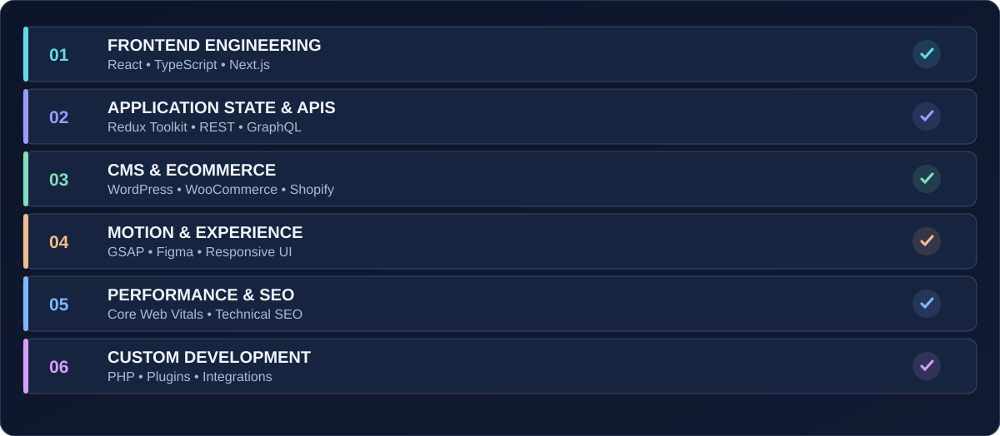
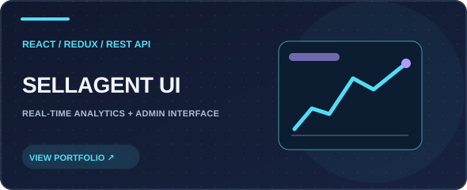
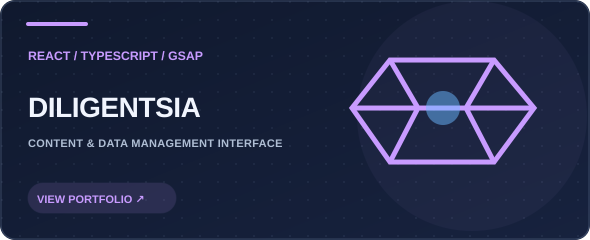
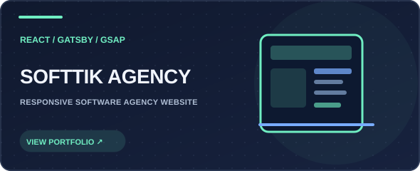
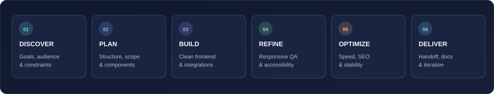

<!--
  ✦ Muhammad Asif • @bitgrav
  A GitHub profile README, designed for the public repository: github.com/bitgrav/bitgrav
  Assets must be uploaded with README.md. Career information reflects the portfolio
  at asif-developer.vercel.app; project cards link to that portfolio rather than
  to unverified individual project websites.
-->

<div align="center">
  <a href="https://asif-developer.vercel.app/"></a>

  <br/>

  <a href="https://asif-developer.vercel.app/"></a>
  <a href="mailto:bitgravpk@gmail.com"></a>
  <a href="https://www.linkedin.com/in/muhammad-asif-frontend-developer/"></a>
  <br/><br/>
  <strong>Engineering modern, high-performance digital experiences — from interface to launch.</strong>
  <br/>
  <sub>⚛️ React + TypeScript &nbsp; · &nbsp; 🛍️ WordPress + Shopify &nbsp; · &nbsp; 🚀 Fast, responsive, design-led builds</sub>
</div>

---

<div align="center">
  <a href="#-about-me">About</a> &nbsp; • &nbsp;
  <a href="#-technical-expertise">Skills</a> &nbsp; • &nbsp;
  <a href="#-featured-projects">Projects</a> &nbsp; • &nbsp;
  <a href="#-professional-background">Experience</a> &nbsp; • &nbsp;
  <a href="#-how-i-work">Process</a> &nbsp; • &nbsp;
  <a href="#-github--open-source">GitHub</a> &nbsp; • &nbsp;
  <a href="#-lets-work-together">Contact</a>
</div>

## 👨‍💻 About me

Hello! I'm **Muhammad Asif**, a **Senior Web Developer** with **7+ years of experience** designing and developing user-friendly, responsive, and high-performance websites and applications.

My work sits at the intersection of **frontend engineering, UI implementation, business websites, eCommerce, and custom integrations**. Whether I'm converting a Figma concept into an interactive React experience or building tailored WordPress functionality, my goal is the same: **make complex products feel simple, polished, and reliable**.

I take care of both the visible details and the underlying implementation: responsive behavior, reusable components, consistent visual systems, integration logic, speed, accessibility considerations, and maintainable code.

```typescript
const asif = {
  name: "Muhammad Asif",
  role: "Senior Web Developer",
  experience: "7+ years",
  specialties: ["React", "TypeScript", "WordPress", "Shopify"],
  priorities: ["Performance", "Responsive UI", "Clean code", "User experience"],
  location: "Pakistan",
  collaboration: "Remote / freelance worldwide",
  portfolio: "https://asif-developer.vercel.app/",
};
```

- 🌍 **Location:** Pakistan · working across time zones.
- 🧑‍💻 **My focus:** frontend apps, SaaS dashboards, company websites, online stores, and custom plugins.
- 🎨 **What excites me:** responsive interfaces, thoughtful animation, intuitive UX, and pixel-conscious implementation.
- 🛠️ **Problem solving:** debugging, component architecture, API integration, automation, and speed improvements.
- 🤝 **Collaboration:** available for freelance, remote teams, long-term product work, and selected open-source projects.
- 🗣️ **Languages:** English, Urdu, and Saraiki.

<div align="center">
  <a href="https://asif-developer.vercel.app/"></a>
</div>

<sub>Portfolio-reported figures. Client work and private repositories aren't necessarily visible in public GitHub activity.</sub>

## 🧰 What I build

| Solution | What I deliver |
| :--- | :--- |
| **Modern web applications** | React and TypeScript frontends, reusable components, interactive pages, and scalable UI foundations. |
| **SaaS products & dashboards** | Clean admin interfaces, analytics presentation, state management, dynamic forms, and API-driven workflows. |
| **WordPress websites** | Responsive business sites, Elementor implementations, theme customization, and custom PHP/plugin functionality. |
| **eCommerce experiences** | Shopify and WooCommerce stores, polished product pages, order workflows, and tailored integrations. |
| **Design-to-code** | Figma, PSD, and XD concepts translated into faithful, responsive interfaces. |
| **Performance & technical SEO** | Faster loading, improved Core Web Vitals, responsive behavior, semantic markup, and search-friendly structure. |
| **Automation & integrations** | REST/GraphQL integrations, custom lead forms, Google Sheets workflows, and practical business process automation. |

## ⚡ Technical expertise

<div align="center">
  
  <br/><br/>
  
  <br/>
  
</div>

### Frontend development

**React.js · Next.js · TypeScript · JavaScript (ES6+) · HTML5 · CSS3 · Redux Toolkit · Gatsby · Tailwind CSS · GSAP**

I build component-driven experiences that balance speed, interactivity, and code maintainability. This includes reusable layouts, dashboard interfaces, form-heavy workflows, stateful views, animations, and responsive behavior across mobile, tablet, and desktop.

### CMS, plugins & eCommerce

**WordPress · Elementor · WooCommerce · Shopify · PHP · Theme customization · Custom plugins**

I work with CMS and commerce ecosystems when clients need a website that is easy to maintain without sacrificing unique functionality. Examples of the work in my portfolio include **automated quote collection, order workflows, customized eCommerce interfaces, and multilingual agency websites**.

### APIs, tools & integrations

**REST API · GraphQL · Redux Toolkit · Google Sheets integrations · Git · GitHub · Figma**

I connect frontend interfaces to business systems and backend services, manage application state, and organize user flows so that useful data moves to the right place. I use Git-based version control and design references to keep development work structured.

### Quality & user experience

**Responsive design · Cross-browser support · Performance optimization · Core Web Vitals · Technical SEO · Testing & debugging · UI motion**

My approach considers real devices and real visitors: predictable layout, clear interaction states, fast-loading pages, readable content, and semantic HTML. I also pay attention to the handoff and long-term maintainability of a project.

<details>
<summary><strong>🔍 More detail: engineering capabilities</strong></summary>

| Focus area | Examples of practical work |
| :--- | :--- |
| UI components | Design systems, reusable cards, navigations, sections, forms, modals, and interactive states. |
| Responsiveness | Fluid typography, breakpoint-aware layouts, touch-friendly controls, and mobile navigation. |
| Data & application state | API consumption, state updates, dashboard presentation, loading states, and form handling. |
| Motion | GSAP-based interaction patterns, UI transitions, scroll effects, and subtle micro-interactions. |
| WordPress development | Elementor sections, WooCommerce customizations, custom PHP features, plugin functionality, and workflows. |
| eCommerce UX | Product presentation, merchandising layouts, checkout-related experiences, and store management flows. |
| Performance | Asset and rendering optimization, layout stability, responsive imagery, and performance diagnostics. |
| Delivery | Debugging, iteration, review, Git-based collaboration, and client handoff. |

</details>

## 🚀 Featured projects

**Nine real projects showcased on my portfolio.** These represent both JavaScript application work and custom CMS/eCommerce builds. The cards below link to my portfolio, where you can explore the full selection.

<table>
<tr>
<td width="50%" valign="top">
      <a href="https://asif-developer.vercel.app/"></a>
      <h3>Breeze Keeper Comfort</h3>
      <p><sub><strong>WordPress · PHP · Custom plugin · APIs</strong></sub></p>
      <p>Created a service-focused HVAC website with a custom estimate/quote workflow. Integrated lead capture with Google Sheets so inquiries can be organized and followed up more efficiently.</p>
      <p><sub>**Focus:** custom functionality, lead generation, automation.</sub></p>
      <p><a href="https://asif-developer.vercel.app/">Explore in my portfolio ↗</a></p>
    </td>
<td width="50%" valign="top">
      <a href="https://asif-developer.vercel.app/"></a>
      <h3>Belgian Jewels</h3>
      <p><sub><strong>WordPress · WooCommerce · Elementor · PHP</strong></sub></p>
      <p>Developed a WooCommerce shopping experience covering product management, call-to-order functionality, automated order creation, and a streamlined order-management flow.</p>
      <p><sub>**Focus:** commerce workflows, usability, product experience.</sub></p>
      <p><a href="https://asif-developer.vercel.app/">Explore in my portfolio ↗</a></p>
    </td>
</tr>
<tr>
<td width="50%" valign="top">
      <a href="https://asif-developer.vercel.app/"></a>
      <h3>Paintball Flow</h3>
      <p><sub><strong>WordPress · Elementor · Figma</strong></sub></p>
      <p>Translated a custom Figma design into a responsive website. Prioritized consistent layouts, careful visual implementation, and a smooth experience across screen sizes.</p>
      <p><sub>**Focus:** design fidelity, responsive interfaces.</sub></p>
      <p><a href="https://asif-developer.vercel.app/">Explore in my portfolio ↗</a></p>
    </td>
<td width="50%" valign="top">
      <a href="https://asif-developer.vercel.app/"></a>
      <h3>ITCYBX Agency</h3>
      <p><sub><strong>WordPress · Elementor · Multilingual</strong></sub></p>
      <p>Developed a business website supporting English and Arabic, with organized service pages, a multilingual structure, and responsive navigation and page layouts.</p>
      <p><sub>**Focus:** content structure, localization, accessibility of navigation.</sub></p>
      <p><a href="https://asif-developer.vercel.app/">Explore in my portfolio ↗</a></p>
    </td>
</tr>
<tr>
<td width="50%" valign="top">
      <a href="https://asif-developer.vercel.app/"></a>
      <h3>SellAgent SaaS Platform</h3>
      <p><sub><strong>React · TypeScript · Gatsby · GSAP</strong></sub></p>
      <p>Worked on a responsive interface for AI-driven sales automation and lead handling. The frontend emphasizes polished interaction patterns and accessible presentation of complex workflows.</p>
      <p><sub>**Focus:** SaaS UI, component-led development, interaction design.</sub></p>
      <p><a href="https://asif-developer.vercel.app/">Explore in my portfolio ↗</a></p>
    </td>
<td width="50%" valign="top">
      <a href="https://asif-developer.vercel.app/"></a>
      <h3>Storewizard SaaS Platform</h3>
      <p><sub><strong>React · TypeScript · Gatsby · GSAP</strong></sub></p>
      <p>Built frontend interfaces for an AI-powered eCommerce assistant platform that helps merchants interact with store automation features through a clear, usable experience.</p>
      <p><sub>**Focus:** React architecture, product interfaces, consistent UX.</sub></p>
      <p><a href="https://asif-developer.vercel.app/">Explore in my portfolio ↗</a></p>
    </td>
</tr>
<tr>
<td width="50%" valign="top">
      <a href="https://asif-developer.vercel.app/"></a>
      <h3>SellAgent Dashboard</h3>
      <p><sub><strong>React · Redux · REST API</strong></sub></p>
      <p>Developed a data-oriented admin interface featuring real-time analytics, inventory-management workflows, and REST API integration.</p>
      <p><sub>**Focus:** dashboard UX, state management, data presentation.</sub></p>
      <p><a href="https://asif-developer.vercel.app/">Explore in my portfolio ↗</a></p>
    </td>
<td width="50%" valign="top">
      <a href="https://asif-developer.vercel.app/"></a>
      <h3>Diligentsia</h3>
      <p><sub><strong>React · TypeScript · GSAP · Gatsby</strong></sub></p>
      <p>Created a React-based experience inspired by Diligentsia, including a responsive interface for organizing, viewing, and managing content and data.</p>
      <p><sub>**Focus:** modular UI, motion, data-centric design.</sub></p>
      <p><a href="https://asif-developer.vercel.app/">Explore in my portfolio ↗</a></p>
    </td>
</tr>
<tr>
<td width="50%" valign="top">
      <a href="https://asif-developer.vercel.app/"></a>
      <h3>Softtik Agency Website</h3>
      <p><sub><strong>React · TypeScript · Gatsby · GSAP</strong></sub></p>
      <p>Built a responsive software-agency website designed to communicate digital services clearly, with clean layouts, modern presentation, and interactive details.</p>
      <p><sub>**Focus:** service storytelling, front-end performance, responsive design.</sub></p>
      <p><a href="https://asif-developer.vercel.app/">Explore in my portfolio ↗</a></p>
    </td>
<td width="50%" valign="top"><p><strong>Want to see the complete portfolio?</strong></p><p>Browse all featured work, technologies, and project details on my website.</p><p><a href="https://asif-developer.vercel.app/">Visit portfolio ↗</a></p></td>
</tr>
</table>

<div align="center">
  <a href="https://asif-developer.vercel.app/"></a>
</div>

## 🏢 Professional background

My portfolio includes experience with **Softtik Technologies (Islamabad)** and **Meta Warriors Club (British Virgin Islands)**, alongside delivery of frontend, WordPress, and eCommerce work for clients.

| Context | What I worked on |
| :--- | :--- |
| **Softtik Technologies** | Digital and software service experiences, web development, responsive page implementation, and frontend delivery. |
| **Meta Warriors Club** | Frontend development and collaboration on interactive web experiences. |
| **Freelance & client projects** | React interfaces, WordPress sites, WooCommerce development, Shopify work, custom functionality, and integrations. |

My experience covers the delivery cycle from **understanding requirements** to **implementing interfaces, integrating features, testing across devices, optimizing performance, and refining the finished product**.

## 🧭 How I work

<div align="center">
  
</div>

**01 — Discover the problem.** I identify the site's purpose, target users, technical requirements, and success criteria before beginning implementation.

**02 — Structure the solution.** I plan sections, component boundaries, design behavior, integrations, and content organization around the real use case.

**03 — Build with care.** I implement reusable frontend components or CMS functionality, keeping responsiveness and maintainability in mind.

**04 — Refine the experience.** I review visual details, alignment, typography, interaction states, and desktop/mobile behavior.

**05 — Optimize & test.** I check usability, loading behavior, accessibility basics, cross-browser consistency, and SEO fundamentals.

**06 — Deliver & improve.** I prepare the result for publishing, address feedback, and refine based on changing project requirements.

### Principles behind my work

- **Clarity over complexity:** make interfaces intuitive before making them flashy.
- **Mobile is a first-class experience:** test touch, spacing, type, and navigation, not just desktop layouts.
- **Animation with purpose:** use movement to provide feedback and hierarchy, not to distract.
- **Performance is a feature:** ship efficient pages and avoid unnecessary visual or JavaScript overhead.
- **Maintainability matters:** build systems that can be updated and extended.
- **Communication closes the loop:** clarify requirements and iterate on feedback.

## 🧪 GitHub & open source

A selection of public repositories and experiments. My GitHub includes UI experiments, component exploration, and frontend practice alongside private/client work.

| Repository | Description | Technology |
| :--- | :--- | :--- |
| [**react-creator-forge ↗**](https://github.com/bitgrav/react-creator-forge) | Frontend experimentation with React components and application tooling. | React · TypeScript · Vite |
| [**animation-react-doodle ↗**](https://github.com/bitgrav/animation-react-doodle) | Interactive frontend and UI animation experiments; [view deployment ↗](https://animation-react-doodle.vercel.app/). | React · TypeScript |
| [**progress ↗**](https://github.com/bitgrav/progress) | Forked React progress component project for reference and exploration. | TypeScript · React |

**What I'm interested in exploring further:** reusable component libraries, dashboard UI patterns, motion systems, practical AI-assisted interfaces, and developer-friendly website tooling.

## 📊 Developer activity

<div align="center">
  
  
</div>

<sub>Statistics are fetched from a third-party service and may occasionally be unavailable; private and client repositories aren't fully represented. Language totals reflect repository content, not a self-assessed proficiency score.</sub>

## 💬 Working together: quick answers

<details>
<summary><strong>Do you work on both new websites and existing projects?</strong></summary>

Yes. My work covers new builds, responsive rebuilds, feature enhancements, API integrations, CMS functionality, and performance improvements.

</details>

<details>
<summary><strong>Can you turn a Figma design into a responsive website?</strong></summary>

Yes. I work with Figma, PSD, and XD references to create responsive HTML/React experiences and WordPress implementations, with careful attention to spacing, typography, layouts, and interaction behavior.

</details>

<details>
<summary><strong>Do you build custom WordPress or WooCommerce functionality?</strong></summary>

Yes. My portfolio includes custom quotation functionality, lead automation, order workflows, WooCommerce customization, and responsive Elementor websites.

</details>

<details>
<summary><strong>Are you available for remote projects?</strong></summary>

Yes. I'm based in Pakistan and available for freelance collaborations with businesses and teams worldwide. Email me with your project requirements and timeline.

</details>

## 🤝 Let's work together

<div align="center">
  <a href="mailto:bitgravpk@gmail.com"></a>
  <br/>
  <a href="mailto:bitgravpk@gmail.com"></a>
  <a href="https://asif-developer.vercel.app/"></a>
  <a href="https://www.linkedin.com/in/muhammad-asif-frontend-developer/"></a>
  <br/><br/>
  📧 **Email:** [bitgravpk@gmail.com](mailto:bitgravpk@gmail.com) &nbsp; · &nbsp; 🌐 **Portfolio:** [asif-developer.vercel.app](https://asif-developer.vercel.app/)  
  💼 **LinkedIn:** [Muhammad Asif](https://www.linkedin.com/in/muhammad-asif-frontend-developer/) &nbsp; · &nbsp; 🐙 **GitHub:** [@bitgrav](https://github.com/bitgrav)
  <br/><br/>
  <sub>Thanks for visiting. If you're building something useful, I'd love to hear about it.</sub>
  <br/>
  <sub>© 2026 Muhammad Asif · Designed with purpose, developed with care.</sub>
</div>
