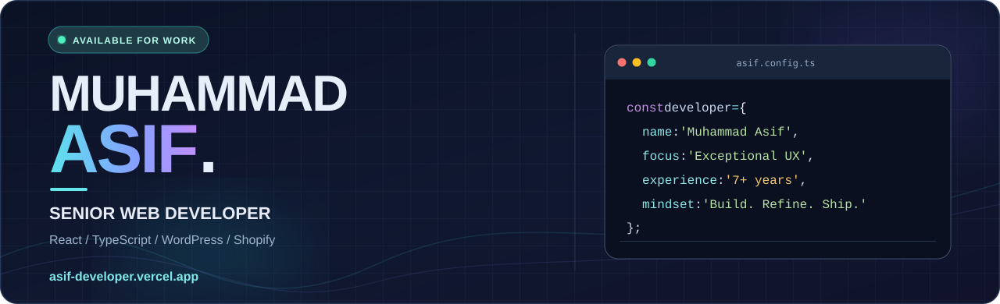
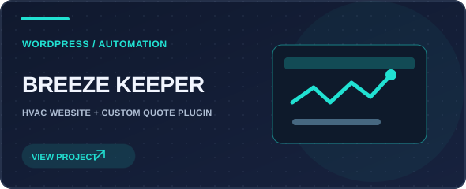
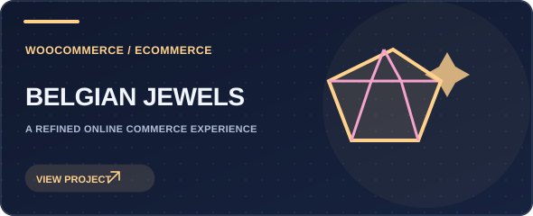
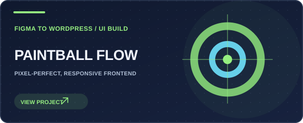
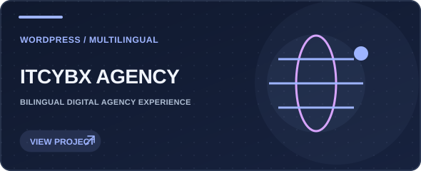
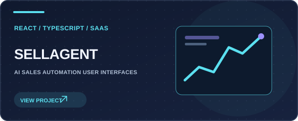
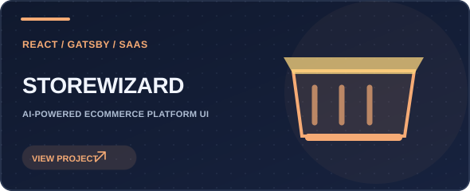

<!--
  Muhammad Asif | GitHub profile README
  Repository: https://github.com/bitgrav/bitgrav
  The SVG artwork is original and stored in ./assets/.
  Replace the portfolio project links below with direct live-project URLs if preferred.
-->

 

  

**I transform ambitious ideas into polished, performant digital experiences.**

⚡ React & TypeScript specialist &nbsp; • &nbsp; 🎨 Detail-driven UI &nbsp; • &nbsp; 🌎 Available for freelance worldwide

---

## ✦ The developer behind the pixels

I'm **Muhammad Asif**, a **Senior Web Developer** with **7+ years** of experience creating fast, responsive, user-centered websites and web applications. I work across modern JavaScript frontends, content management systems, eCommerce experiences, and custom web integrations.

I care about the things users notice — fluid interactions, polished layouts, accessible-to-use interfaces — and the things they don't: maintainable code, performance, clean integrations, and a reliable delivery process.

- 🚀 **Currently building:** responsive React applications, SaaS frontends, eCommerce solutions, and custom WordPress functionality.
- 🧩 **What I enjoy:** translating Figma designs into production-ready experiences, solving UI problems, and improving performance.
- 🤝 **Open to:** freelance opportunities, remote collaborations, and thoughtful open-source projects.
- 📍 **Based in:** Pakistan · Working with clients worldwide.
- 💬 **Let's talk:** [Email](mailto:bitgravpk@gmail.com) · [LinkedIn](https://www.linkedin.com/in/muhammad-asif-frontend-developer/) · [Portfolio](https://asif-developer.vercel.app/)

  

## ⚡ Technology stack

 

 

| Discipline | Skills & tools |
| :--- | :--- |
| **Frontend engineering** | React.js · Next.js · TypeScript · JavaScript (ES6+) · HTML5 · CSS3 · Redux Toolkit · Gatsby · Tailwind CSS · GSAP |
| **WordPress & eCommerce** | WordPress · Elementor · WooCommerce · Shopify · PHP · Custom WordPress plugins · Theme customization |
| **Integrations & APIs** | REST APIs · GraphQL · Google Sheets integrations · Lead capture and workflow automation |
| **UI implementation** | Figma-to-code · Responsive layouts · Cross-browser compatibility · UI/UX implementation · Interactive animations |
| **Quality & delivery** | Core Web Vitals · Performance optimization · Technical SEO · Testing & debugging · Git & GitHub |

## 🚀 Selected work

Six projects from my portfolio — showcasing everything from custom WordPress workflows to modern React SaaS interfaces. Click a card to explore my portfolio.

 

<table>
  <tr>
    <td width="50%" valign="top">
      
       <strong>Breeze Keeper Comfort</strong> 
      HVAC website with a custom estimation plugin, automated lead capture, and Google Sheets integration.
    </td>
    <td width="50%" valign="top">
      
       <strong>Belgian Jewels</strong> 
      WooCommerce shop with product management, call-to-order flows, and order automation.
    </td>
  </tr>
  <tr>
    <td width="50%" valign="top">
      
       <strong>Paintball Flow</strong> 
      Responsive, Figma-to-WordPress implementation focused on design fidelity and usability.
    </td>
    <td width="50%" valign="top">
      
       <strong>ITCYBX Agency</strong> 
      English/Arabic digital agency site with structured service pages and responsive layouts.
    </td>
  </tr>
  <tr>
    <td width="50%" valign="top">
      
       <strong>SellAgent</strong> 
      React-based SaaS interfaces for AI sales automation, dashboards, and lead workflows.
    </td>
    <td width="50%" valign="top">
      
       <strong>Storewizard</strong> 
      AI-powered eCommerce platform frontend with a modern, scalable UI built with React.
    </td>
  </tr>
</table>

## 🧪 Open-source & GitHub experiments

| Repository | What you'll find |
| :--- | :--- |
| [**react-creator-forge ↗**](https://github.com/bitgrav/react-creator-forge) | A React + TypeScript project using Vite, Tailwind CSS, and UI component tooling. |
| [**animation-react-doodle ↗**](https://github.com/bitgrav/animation-react-doodle) | A React / TypeScript UI experiment, with a [live deployment ↗](https://animation-react-doodle.vercel.app/). |
| [**progress ↗**](https://github.com/bitgrav/progress) | A fork of `react-component/progress`, a React progress-bar component. |

## 🧠 How I can help

| | |
| :--- | :--- |
| **01 · Modern frontend** | React apps, TypeScript interfaces, component architecture, dashboards, and smooth interactions. |
| **02 · WordPress engineering** | Elementor builds, custom plugins, WooCommerce functionality, and integrations tailored to business needs. |
| **03 · Online stores** | Shopify / WooCommerce storefronts with responsive shopping experiences and streamlined workflows. |
| **04 · Figma to production** | Responsive, pixel-conscious implementations from Figma, PSD, or XD files. |
| **05 · Speed & discoverability** | Page speed, Core Web Vitals, technical SEO, and front-end optimization. |

## 📈 GitHub activity

  
  

GitHub cards reflect public repository activity and may not include private or client projects.

## 💌 Let's create something remarkable

 

  
Designed with purpose. Built with care. — Muhammad Asif © 2026

